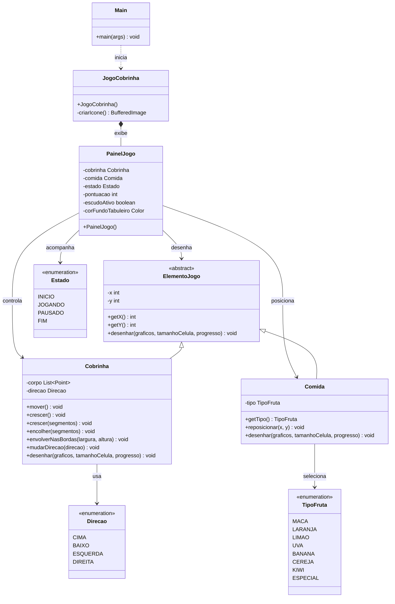

# Jogo da Cobrinha

Jogo arcade desenvolvido em Java com Swing. Controle a cobrinha, colete a comida e aumente sua pontuação sem bater nas paredes ou no próprio corpo. A interface usa tema escuro, detalhes neon, tabuleiro texturizado e animações suaves.

## Índice

- [Recursos](#recursos)
- [Requisitos e execução](#requisitos-e-execução)
- [Controles](#controles)
- [Estrutura do projeto](#estrutura-do-projeto)
- [Diagrama de classes](#diagrama-de-classes)
- [Orientação a objetos](#orientação-a-objetos)

## Recursos

- Movimento interpolado e controles por teclado.
- Oito variedades de frutas, incluindo uma fruta dourada rara, com poderes próprios.
- Pontuação, crescimento e detecção de colisões.
- Pausa, reinício e condição de vitória ao preencher o tabuleiro.
- Seletores independentes para personalizar a cor da cobrinha e do fundo do tabuleiro.
- Interface Swing sem dependências externas.

## Requisitos e execução

- JDK 17 ou superior.
- Nenhuma biblioteca externa necessária.

Na raiz do projeto, compile e execute:

```powershell
javac -encoding UTF-8 -d out src/main/java/br/com/jogopoo/*.java
java -cp out br.com.jogopoo.Main
```

## Controles

| Ação | Teclas |
| --- | --- |
| Mover | Setas ou **W, A, S, D** |
| Começar ou reiniciar | **Espaço**, **Enter** ou botão na tela |
| Pausar ou continuar | **P** ou **Esc** |
| Alterar cor da cobrinha | Botão **Cobrinha** no cabeçalho |
| Alterar fundo | Botão **Fundo** no cabeçalho |

Ao abrir o seletor de cor durante uma partida, o jogo pausa temporariamente.

## Poderes das frutas

| Fruta | Poder |
| --- | --- |
| Maçã | Cresce dois segmentos em vez de um. |
| Laranja | Aumenta a velocidade por 5 segundos. |
| Limão | O escudo absorve uma colisão; se atingir uma parede, a cobrinha reaparece no lado oposto. |
| Uva | Duplica os pontos ganhos por 5 segundos, incluindo os pontos da própria uva. |
| Banana | Reduz a velocidade por 5 segundos. |
| Cereja | Concede 30 pontos bônus além dos 10 pontos normais. |
| Kiwi | Encolhe a cobrinha em até dois segmentos, mantendo o mínimo de três. |
| Fruta dourada | Aparece com 10% de chance; cresce dois segmentos e ativa turbo, escudo e pontos 2x por 5 segundos. |

Os efeitos temporários param enquanto a partida está pausada. Os poderes ativos aparecem no cabeçalho.

## Estrutura do projeto

```text
src/main/java/br/com/jogopoo/
├── Main.java             # Inicializa a aplicação Swing
├── JogoCobrinha.java     # Janela principal
├── PainelJogo.java       # Interface, estado e regras da partida
├── ElementoJogo.java     # Abstração dos elementos do tabuleiro
├── Cobrinha.java         # Movimento, corpo e aparência da cobrinha
└── Comida.java           # Comida coletável
```

## Diagrama de classes



## Orientação a objetos

- **Abstração:** `ElementoJogo` define posição e o contrato `desenhar(...)` sem determinar a representação de cada elemento.
- **Encapsulamento:** coordenadas, corpo, direção e cores são protegidos pelas classes responsáveis. A direção é alterada por `mudarDirecao(...)`, que impede uma inversão imediata.
- **Herança:** `Cobrinha` e `Comida` especializam `ElementoJogo` e herdam sua posição.
- **Polimorfismo:** `PainelJogo` percorre elementos como `ElementoJogo`; cada classe fornece sua própria implementação de `desenhar(...)`.

`Main` inicia a interface na Event Dispatch Thread do Swing. `JogoCobrinha` monta a janela, enquanto `PainelJogo` coordena entrada, temporização, estado da partida, colisões e desenho da interface.
